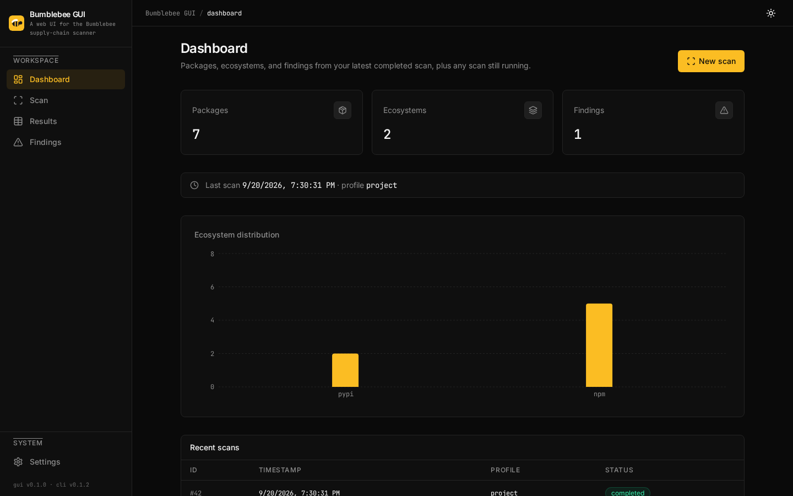
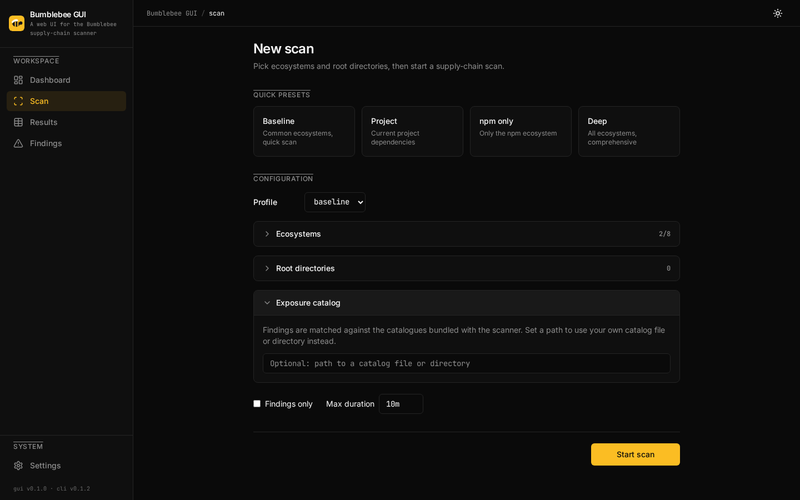
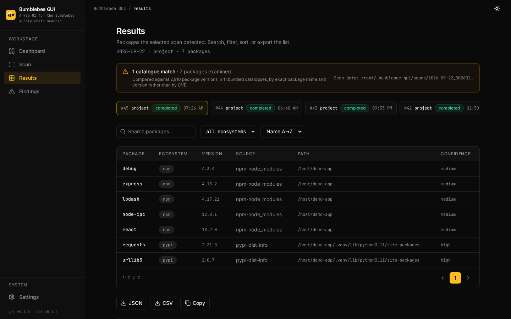
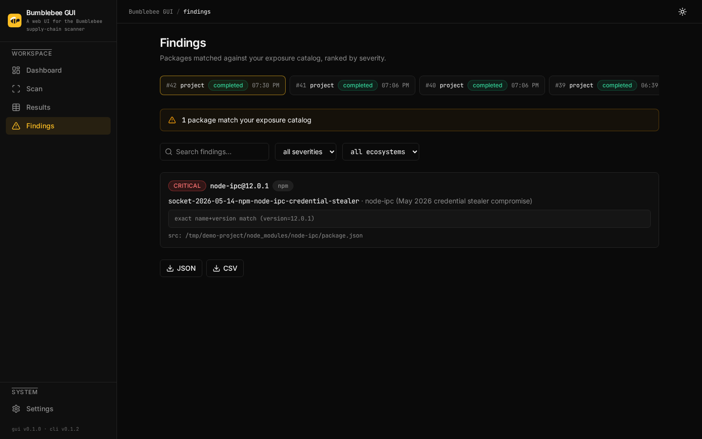
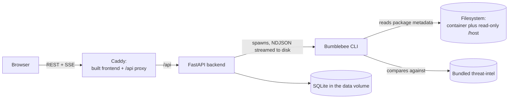
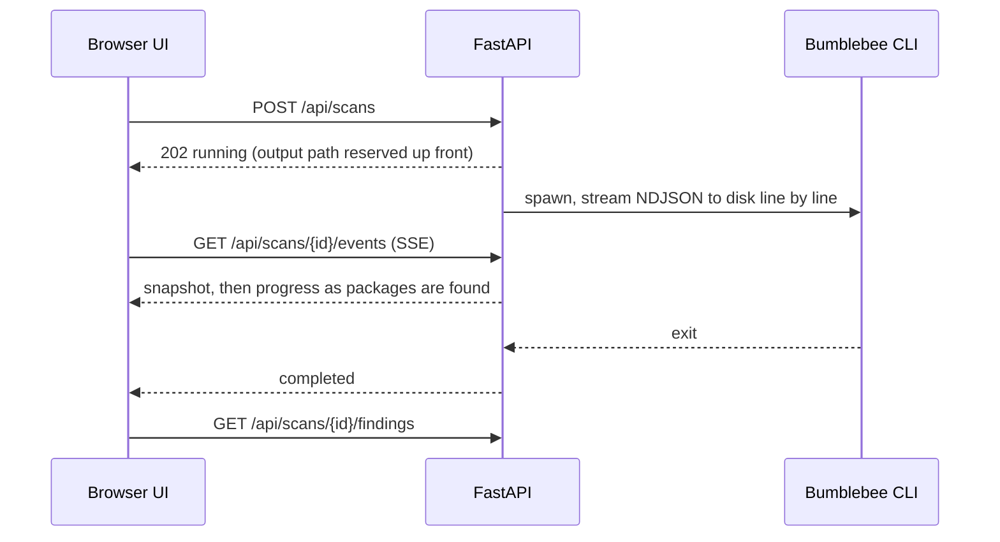

# Bumblebee GUI

A web interface for [Bumblebee](https://github.com/perplexityai/bumblebee), the open source supply chain
security scanner from Perplexity AI.

This is an unofficial interface for that scanner. It is not affiliated with or endorsed by Perplexity AI.

Bumblebee walks a filesystem, reads package metadata across a dozen ecosystems, and reports anything that
matches a published compromise. It is a CLI, which suits some people and not others. Bumblebee GUI wraps it in
a web app: point it at a directory, run a scan, watch progress stream in, and read the result as a table you
can filter, sort and export.



## What it does

- Runs scans in the background and streams live progress to the browser over Server-Sent Events, so nothing
  blocks while a big tree is walked
- Compares every package it finds against the bundled exposure catalogues and reports matches by severity
- Filters, searches and sorts results, and exports them as JSON or CSV
- Keeps a scan history you can revisit, and cancels a running scan on request
- Scans a read-only mount of a host directory, without handing the container anything else
- Ships light and dark themes

## Quick start

You need Docker and Docker Compose, plus Safari 16.4+, Chrome 111+, or Firefox 128+.
The browser minimums come from [Tailwind CSS 4](https://tailwindcss.com/docs/compatibility).

```bash
git clone https://github.com/ruangraung/bumblebee-gui.git
cd bumblebee-gui
docker compose up -d
```

Then open <http://localhost:5173>. Caddy serves the built frontend there and proxies `/api` to the backend,
which listens on <http://localhost:8001> and documents itself at <http://localhost:8001/docs>.

Both ports are bound to loopback, so nothing is reachable from another machine by default. If either port is
already taken, compose fails with `Bind for 127.0.0.1:5173 failed: port is already allocated` before the
stack comes up: stop whatever holds the port, or change the mapping in `docker-compose.yml`. A new install
opens on an empty scan history, which is the expected first sight, and what a scan with no matches means is
covered under [Exposure catalogues](#exposure-catalogues).

A scan reads the filesystem inside the container, which is the Python environment the scanner itself runs in.
That makes a useful smoke test, but it says nothing about your machine. Mount a directory to scan real code.

### Your first scan

1. Open the **Scan** page.
2. Pick a profile (`baseline`, `project` or `deep`) and any ecosystems you care about.
3. Press **Start Scan**. The scan runs server side and the page fills in as packages are found.
4. Packages and any matching findings appear when it finishes.

### Scanning a directory on your machine

The backend runs in a container, so by default a scan sees only the container's own filesystem. To scan a
directory that lives on the host, mount it read-only at `/host`:

```bash
cd bumblebee-gui        # the compose files live in the repo root
BUMBLEBEE_HOST_DIR=/home/you/projects \
  docker compose -f docker-compose.yml -f docker-compose.host-scan.yml up -d backend

docker compose exec backend ls /host    # must list your projects, not be empty
```

`/host` **is** the directory named in `BUMBLEBEE_HOST_DIR`. With `BUMBLEBEE_HOST_DIR=$HOME/projects`, a
repository at `~/projects/api` is scanned with the root `/host/api`, and `/host` on its own scans everything
under the mount. The **Project** preset already uses `/host` as its root.

A path from your machine is not a path inside the container. `~`, `~/projects` and `/Users/you/projects` do
not exist there, and typing one cannot reach your files. `/host`, or a path under it, is the only form that
works.

If `BUMBLEBEE_HOST_DIR` names a directory that does not exist, Docker creates it empty, and the mount is empty
with it. The `ls /host` line above is what catches that before a scan reports nothing.

Every command that names `docker-compose.host-scan.yml` needs `BUMBLEBEE_HOST_DIR` set, because that file
requires it. Compose refuses the command otherwise, and that includes stopping the stack:

```bash
BUMBLEBEE_HOST_DIR=/home/you/projects \
  docker compose -f docker-compose.yml -f docker-compose.host-scan.yml down
```

Commands that name only `docker-compose.yml`, including the `docker compose exec` line above, do not need it.

The mount is read-only, so nothing in the container can change what the scanner sees. Everything under that
directory does become readable by the backend, which listens on localhost only, so mount the narrowest
directory that answers your question.

## Exposure catalogues

A scanner can only report what it has something to compare against. Bumblebee GUI ships the catalogues and
points the scanner at them, so a scan reports real matches without any setup.

The catalogues come from upstream's `threat_intel` set, pinned at commit `c1e83c0`: **fifteen catalogues,
1,103 entries**, covering npm, pypi, rubygems, go, packagist and editor-extension. Each one describes a real
published campaign, with its source report attached.

The scanner is built from a pinned commit for the same reason. Upstream has published no release since
`v0.1.2`, while the catalogues it maintains moved to schema `0.2.0`, which `v0.1.2` refuses to load. A released
binary therefore cannot read today's data. The image clones commit `c1e83c0`, asserts that commit after
checkout, compiles the CLI with the Go toolchain, and fails the build if the binary does not start.

Matching is exact: a package is reported when its ecosystem, name and version are all one of those 1,103
entries. A scan that reports no matches has found that none of the packages it saw is on the list, which is a
narrow result worth reading carefully. The catalogues record specific compromised releases rather than a
general vulnerability database, so a package the list does not mention is not covered by it, and a clean scan
is not a claim that everything it scanned is safe.

| What the scan request says | What the scan compares against |
|---|---|
| A path | That catalog file or directory |
| An empty string | Nothing, which is how you ask for a pure inventory scan |
| Nothing at all | The bundled catalogues |

Every file's sha256 is pinned in [`threat-intel.manifest`](threat-intel.manifest) and verified while the image
is built, because this data decides whether a package gets reported as malicious. The catalogues are a
snapshot rather than a feed: a new campaign reaches the image when the pinned commit is bumped, which shows up
as a reviewable change to the digests.

That pin is checked weekly by [`.github/workflows/catalogue-pin.yml`](.github/workflows/catalogue-pin.yml), which
compares the pinned commit with upstream's latest release, checks each manifest digest against the file at that
commit, and reports the entry count in the run log. It reads only and opens nothing. A failed run means the pin
is behind a published release, or a digest no longer matches, and the fix is a bump pull request.

To use your own, put a path in the scan form's exposure catalogue field. A file or a directory of `.json`
catalogues both work.

## Screenshots

| | |
|---|---|
|  |  |
| Scan configuration | Results |
|  |  |
| Dashboard | Findings |

These come from a demo scan of a throwaway project built to contain one package that a published campaign
compromised. No real environment appears in them.

## Architecture



Caddy serves the built frontend and proxies `/api` to the backend, and the boundaries between the processes
are the interesting part. The browser never talks to the scanner; the backend never parses package metadata
itself. The CLI does the walking and emits NDJSON, the backend turns that into records and serves them, and
the browser renders what it is given.

## Scan lifecycle



Cancelling works the same way in reverse: `DELETE /api/scans/{id}` cancels the task, kills the subprocess,
and removes the partial output.

## API

| Method | Endpoint | Description |
|--------|----------|-------------|
| `GET` | `/api/health` | Health check |
| `POST` | `/api/scans` | Submit a scan, returns `202` with a `running` record |
| `GET` | `/api/scans` | List recent scans |
| `GET` | `/api/scans/{id}` | Scan details, including live `packages_found` while running |
| `GET` | `/api/scans/{id}/events` | SSE stream: `snapshot`, `progress`, `completed` / `failed` / `cancelled` |
| `DELETE` | `/api/scans/{id}` | Delete a scan, cancelling it first if it is still running |
| `GET` | `/api/scans/{id}/packages` | Packages from a completed scan |
| `GET` | `/api/scans/{id}/findings` | Catalogue matches from a completed scan |
| `GET` | `/api/scans/{id}/export` | Export scan data as JSON or CSV |

### What a scan records about itself

Every scan stores a receipt describing what it ran with, written when the scan
starts rather than reconstructed afterwards. It holds the scanner version and
commit, the requested and resolved roots, the ecosystems and options, and the
catalogue that was compared against, with a `sha256` digest of each catalogue
file. `exposure_comparison` says whether packages were actually compared against
a catalogue, so an inventory-only scan cannot be read as though matching ran.

The purpose is that an old result stays explicable. Rebuilding the image with
newer catalogues changes the current install, not the record of what a previous
scan used. Scans written before receipts existed report `receipt: null`, which
means unknown provenance, not the catalogues installed today.

## Scan profiles

| Profile | Use case | Scans |
|---------|----------|-------|
| `baseline` | Daily lightweight inventory | Global package roots, toolchains, extensions |
| `project` | Project workspace inventory | The mounted `/host` directory |
| `deep` | Incident response | Explicit root paths, full home directory |

`deep` is the incident-response profile and refuses to run without an explicit root, because it will not guess
which paths matter. The scan form leaves max duration empty by default, which sends no limit at all and keeps
the scanner's own behaviour. Set `30s`, `10m` or `2h` to cap a scan, or `0` for no limit.

## What has actually been tested

Honest table, because a README that claims more than it has run is worse than a short one.

| Path | Status |
|---|---|
| Linux with Docker Compose | **Verified.** Scans of a 780 package tree, catalogue matching against a compromised fixture, the full test suite and all six required checks |
| macOS with Docker Compose | **Verified.** A fresh clone on macOS under OrbStack, mounting a home directory and scanning it. OrbStack has to be granted access to the mounted directory, or the mount reads as empty inside the container |
| Windows | **No native path.** Upstream publishes no Windows build of the scanner. Docker Desktop runs the Linux container, so it may well work, but nothing has been checked there |
| Native install without Docker | **Refused.** `install.sh` stops with a message and a non-zero exit. Native packaging, meaning a Python environment, the Node build, the scanner binary and the catalogue set, does not exist yet |

If you try a path that is not verified, an issue describing what happened is genuinely useful.

## Development

Prerequisites: Python 3.11+, Node 22+, Docker (recommended).

### With Docker

The default stack is the production one: Caddy serves the built frontend, and the backend runs the code baked
into the image as an unprivileged user, without the autoreloader.

```bash
docker compose up -d
docker compose logs -f
docker compose down
```

For development with hot reload, add the dev override. It mounts the source trees and runs the Vite dev server
and the backend autoreloader:

```bash
docker compose -f docker-compose.yml -f docker-compose.dev.yml up
```

Dependencies for the frontend are installed inside the image, so there is nothing to run on the host. With the
dev override, edits under `frontend/src` and `backend/bumblebee_gui` reload on their own.

### Without Docker

```bash
cd backend
python -m venv venv && source venv/bin/activate
pip install -r requirements-dev.txt
uvicorn bumblebee_gui.main:app --reload --port 8000

# in another terminal
cd frontend
npm install
npm run dev
```

The scanner binary is expected at `/usr/local/bin/bumblebee`, overridable with `BUMBLEBEE_BINARY`.

## Testing

```bash
cd backend && python -m pytest tests -q
cd frontend && npm run test && npm run build
```

The backend suite covers command building, NDJSON parsing, record mapping, the subprocess streaming and
cancellation path, the async scan lifecycle, and the session-cookie auth and docs guard. The frontend suite
covers the pure logic in `src/lib` (export encoding, filtering, sorting and date handling) and, under jsdom,
the auth store and the sign-in gate.

### CI gates

Every push and pull request runs six required checks:

1. **Socket** supply-chain scan
2. **Gitleaks** secret scan
3. **Dependency audits**, `pip-audit` for the backend and `npm-audit` with an exception list for the frontend, both hard gates
4. **Backend and frontend**: pytest, vitest, `tsc` and the production build
5. **CodeScene Code Health**, which blocks hotspots from declining and new code from arriving unhealthy
6. **Browser tests** (Playwright) against the built bundle

An advisory that has no patched release and is disputed upstream cannot be cleared by an upgrade. Instead
`frontend/audit-exceptions.json` names it once, with the packages it covers, the date it lapses and the
evidence behind it, and `frontend/scripts/audit-gate.mjs` fails the build on anything else, on a report it
cannot read, and on an exception whose date has passed. Each entry is meant to disappear again.

## Data storage

Scan data lives in `~/.bumblebee-gui/`, overridable with `BUMBLEBEE_DATA_DIR`. In the Docker stack the backend
runs as the unprivileged `bumblebee` user, with the data in the `bumblebee-data` volume at
`/home/bumblebee/.bumblebee-gui`:

```
~/.bumblebee-gui/
|-- bumblebee-gui.db
`-- scans/
    `-- 2026-05-27_baseline_170000.ndjson
```

## Security

- **Local by default.** The API binds to localhost and makes no network calls at runtime.
- **Read-only scanning.** The scanner reads metadata and never writes to the tree it is scanning.
- **Nothing baked in blindly.** The bundled threat intel is pinned by commit and verified per file during the
  image build, and the CLI binary is pinned by version and sha256 for the same reason.
- **No credentials in the code.** Configuration comes from the environment.
- **Scan roots reach the container's filesystem by design.** The scanner walks the container it
  lives in, so requested roots are not confined to the host mount. The API answers only to the
  Host names it knows: localhost, 127.0.0.1, the compose proxy name, and whatever you add through
  `BUMBLEBEE_ALLOWED_HOSTS`. If you serve the API beyond loopback, add those host names and set
  `BUMBLEBEE_API_TOKEN`. The UI then asks for the token once and exchanges it for an HttpOnly session cookie
  that authenticates later calls, including the live-progress stream; the same token guards `/docs`, `/redoc`
  and `/openapi.json`.
- **Unprivileged runtime.** The backend container runs as a non-root user, and the default stack serves the
  built frontend through Caddy rather than a development server.
- **Six required checks on every change**, listed above.

## Contributing

See [CONTRIBUTING.md](CONTRIBUTING.md). Issues and pull requests are welcome, including the
"I tried the macOS path and here is what broke" kind.

## AI-assisted development

This project is built with AI assistance, and changes arrive as pull requests that a human reviews before they
merge. Saying so seems better than leaving a reader to guess.

## License

Apache-2.0. See [LICENSE](LICENSE).

The Docker image builds Perplexity's Bumblebee CLI from upstream source at a pinned commit; the CLI is also
Apache-2.0, and the exposure catalogues are fetched from the same project at build time. Attribution and the
exact commits are recorded in [THIRD-PARTY-NOTICES.md](THIRD-PARTY-NOTICES.md).

## Acknowledgments

- [Bumblebee](https://github.com/perplexityai/bumblebee) by Perplexity AI, the scanner this wraps and the
  source of the exposure catalogues
- [shadcn/ui](https://ui.shadcn.com/) for the components
- [FastAPI](https://fastapi.tiangolo.com/) for the API framework
- [React](https://react.dev/) for the frontend
